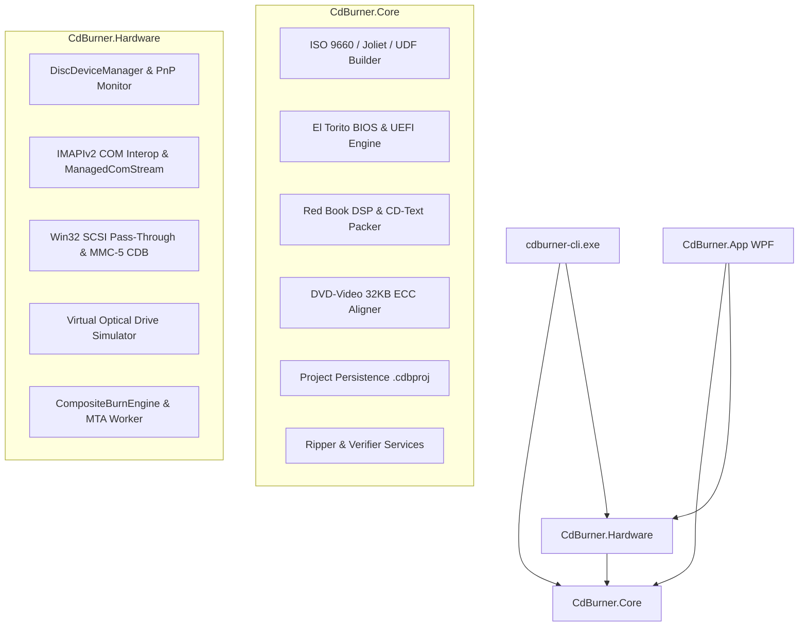

# CdBurner

[](https://dotnet.microsoft.com/)
[](LICENSE)
[]()
[]()

**CdBurner** is a high-performance, professional optical disc authoring, burning, ripping, and mastering suite for Windows 10 and Windows 11. Engineered from the ground up on **.NET 10 (`net10.0-windows10.0.22621.0`)**, CdBurner combines dual low-level hardware backends—Windows Image Mastering API v2 (**IMAPIv2**) and direct Win32 SCSI Pass-Through (**SPTI** with MMC-5 command descriptors)—with a fully autonomous, deterministic **Virtual Optical Drive Simulator** enabling 100% automated CI/CD testing without physical optical hardware.

---

## Table of Contents
1. [Key Features](#key-features)
2. [Feature Matrix](#feature-matrix)
3. [Architecture Overview](#architecture-overview)
4. [Command-Line Interface (`cdburner-cli.exe`)](#command-line-interface-cdburner-cliexe)
5. [Windows 11 Fluent Desktop UI (`CdBurner.App.exe`)](#windows-11-fluent-desktop-ui-cdburnerappexe)
6. [Virtual Optical Drive Simulator](#virtual-optical-drive-simulator)
7. [Project Persistence (`.cdbproj`)](#project-persistence-cdbproj)
8. [Build, Test & Publish Guide](#build-test--publish-guide)

---

## Key Features

- **Multi-Format Data Authoring**: Generate ISO 9660 (Levels 1, 2, 3 with 8.3 and 31-character identifiers), Joliet (UCS-2BE Unicode for long file paths), and UDF (1.02, 1.50, 2.01, 2.60) filesystems simultaneously or selectively.
- **Dual BIOS & UEFI Bootable Media**: Author El Torito bootable media with hybrid x86 BIOS boot sectors and UEFI 64-bit EFI system partitions on a single disc.
- **Red Book Audio CD Mastering**: Burn gapless Disc-at-Once (DAO) and Track-at-Once (TAO) audio discs with Lead-In CD-Text (pack generation with CRC-16-CCITT), DSP peak normalization, and 2352-byte sector boundary padding.
- **DVD-Video Mastering**: Enforce strict 32 KB (16-sector) ECC boundary separation between `.IFO` and `.BUP` files in canonical `VIDEO_TS` layout, with automatic layer-break calculation for DVD-9 dual-layer media.
- **Digital Audio Extraction & Disc Ripping**: Rip data discs to `.iso` and audio discs to `.wav` files with synchronized `.cue` sheets, defect-map retry loops, and bad sector logging.
- **Drive Utilities**: High-speed quick erase and forensic full erase for CD-RW, DVD-RW, DVD+RW, DVD-RAM, and BD-RE; DVD+R bitsetting (book-type modification to DVD-ROM); and high-resolution sector surface scanning.
- **Dual Hardware Interop**: Connects seamlessly to Windows optical devices via IMAPIv2 COM interfaces (`IDiscRecorder2`, `IDiscFormat2Data`, `IDiscFormat2TrackAtOnce`, `IDiscFormat2Erase`) and direct SCSI pass-through (`IOCTL_SCSI_PASS_THROUGH_DIRECT`) executing SCSI Multi-Media Commands (MMC-5).
- **Virtual Optical Drive Simulator**: Comprehensive in-memory, thread-safe SCSI MMC-5 simulator supporting virtual CD, DVD, and Blu-ray media with runtime defect injection and realistic speed curves.

---

## Feature Matrix

| Category | Capability | Standards / Specifications |
| :--- | :--- | :--- |
| **Data Disc Filesystems** | ISO 9660 | Levels 1, 2, 3; Interchange Level 1; strict 8.3 & 31-char filenames |
| | Joliet | Unicode (UCS-2BE) directory records, max 64-char filename length |
| | UDF | OSTA UDF 1.02, 1.50, 2.01, 2.60; Anchor Volume Descriptor Pointers at LBA 256 |
| | El Torito Bootable | Validation Entry, Initial/Default BIOS Entry, Additional Section Entries (UEFI EFI) |
| | Multi-Session | Session import, previous TOC bridging, session merging, multi-session continuation |
| **Audio CD (Red Book)** | Recording Modes | Disc-at-Once Gapless (DAO), Track-at-Once (TAO, 150-frame pre-gap) |
| | Audio DSP | Media Foundation PCM decoder, peak normalization DSP, 2352-byte padding |
| | CD-Text | Lead-In subchannel binary pack generator (Album/Track Title, Performer, ISRC, CRC-16) |
| | CUE Sheets | Full CDRWIN CUE sheet parser and generator (INDEX 00/01, PREGAP, POSTGAP, CD-TEXT) |
| **DVD-Video** | Canonical Structure | `VIDEO_TS` and optional `AUDIO_TS`; IFO, BUP, and VOB verification |
| | ECC Alignment | 32 KB (16-sector) physical separation between `.IFO` and `.BUP` backup tables |
| | Dual-Layer Break | DVD-9 Layer 0 / Layer 1 calculation with 16-sector ECC boundary alignment |
| **Ripping & Verification** | Disc Ripping | Data disc to `.iso`; Audio CD Digital Audio Extraction (DAE) to `.wav` + `.cue` |
| | Post-Burn Verification | Sector-by-sector readback checksums (CRC32, MD5, SHA-256) and defect mapping |
| | Surface Scanner | Block-level transfer rate benchmarking, latency profiling, Good/Slow/Damaged defect map |
| **Media Operations** | Erasure | Quick erase (PMA/TOC clearing) and Full erase (physical sector blanking) |
| | Media Supported | CD-R, CD-RW, DVD-R, DVD-RW, DVD+R, DVD+RW, DVD-RAM, DVD+R DL, BD-R, BD-RE |
| | Bitsetting | DVD+R and DVD+R DL book type modification to DVD-ROM for legacy standalone players |
| **Execution Modes** | Headless CLI | `cdburner-cli.exe` with System.CommandLine parser and scriptable exit codes |
| | GUI Application | `CdBurner.App.exe` with Windows 11 Fluent UI, MVVM, and PerMonitorV2 High-DPI |
| | Virtual Simulator | Thread-safe in-memory virtual recorder backend (`VirtualDiscRecorder`) |

---

## Architecture Overview



### Solution Projects

- **`src\CdBurner.Core`**: Domain models, optical constants (`2048` data sectors, `2352` raw audio sectors), ISO/Joliet/UDF image generator, El Torito boot catalog builder/inspector, Media Foundation audio decoder, DSP normalization, CD-Text packer, DVD-Video layout planner, and `.cdbproj` JSON serialization.
- **`src\CdBurner.Hardware`**: Windows IMAPIv2 COM wrappers, Win32 `DeviceIoControl` SCSI pass-through direct, MMC-5 command descriptor block (CDB) builders, drive enumeration and PnP hardware change monitoring, MTA thread marshaling, and the `VirtualDiscRecorder` simulation engine.
- **`src\CdBurner.Cli`**: Autonomous command-line application (`cdburner-cli.exe`) for headless and automated environments.
- **`src\CdBurner.App`**: Windows 11 Fluent WPF application featuring modern theme styling, MVVM CommunityToolkit architecture, PerMonitorV2 DPI awareness manifest, and real-time burn progress telemetry.
- **`tests\*`**: Comprehensive xUnit test suite featuring 339 unit and integration tests across 24 autonomous development phases.

---

## Command-Line Interface (`cdburner-cli.exe`)

The headless CLI tool provides comprehensive optical disc authoring, burning, ripping, and testing capabilities suitable for PowerShell scripts, batch files, and continuous integration pipelines.

### General Syntax
```powershell
cdburner-cli.exe [command] [options]
```

### Available Commands

| Command | Description |
| :--- | :--- |
| `list-drives` | Enumerates physical and virtual optical disc recorders with drive letters and capabilities. |
| `burn-iso` | Burns an existing `.iso` disc image file to physical or virtual media. |
| `burn-data` | Compiles a local folder into an ISO 9660/Joliet/UDF filesystem and burns it to media. |
| `burn-audio` | Burns an Audio CD compilation from `.wav` files with CD-Text and optional normalization. |
| `rip-iso` | Rips an optical data disc to a raw `.iso` image on disk. |
| `rip-audio` | Digital Audio Extraction (DAE) ripping all tracks to `.wav` files and generating a `.cue` sheet. |
| `erase` | Erases rewritable media (CD-RW, DVD-RW, DVD+RW, DVD-RAM, BD-RE). |
| `scan` | Performs a surface read scan and transfer rate benchmark to detect damaged sectors. |
| `verify` | Compares disc contents against a reference `.iso` image using cryptographic hashing. |

### CLI Usage Examples

#### 1. List Available Optical Recorders
```powershell
cdburner-cli.exe list-drives
```
*Output:*
```text
Found 2 optical drive(s):
  [0] Drive D: (HL-DT-ST BD-RE WH16NS40) [Physical]
      Capabilities: CD-R, CD-RW, DVD-R, DVD+R, DVD-RW, DVD+RW, BD-R, BD-RE
      Media: CD-R 700 MB (Blank)
  [1] Virtual Drive (VDRV-01) [Virtual Simulator]
      Capabilities: All Media Supported
      Media: DVD-R 4.7 GB (Blank)
```

#### 2. Burn an ISO Image with Post-Burn Verification and Auto-Eject
```powershell
cdburner-cli.exe burn-iso --drive D: --image "C:\Images\ubuntu-26.04.iso" --speed 16 --verify --eject
```

#### 3. Burn a Data Directory with Dual BIOS & UEFI El Torito Boot
```powershell
cdburner-cli.exe burn-data --drive D: `
  --source "C:\Deployment\Installer" `
  --label "BOOT_INSTALLER" `
  --bios-boot "C:\Deployment\Boot\etfsboot.com" `
  --uefi-boot "C:\Deployment\Boot\efisys.bin" `
  --verify
```

#### 4. Burn a Gapless Red Book Audio CD with CD-Text
```powershell
cdburner-cli.exe burn-audio --drive D: `
  --tracks "01.wav" "02.wav" "03.wav" `
  --album "Synth Harmonics" `
  --artist "Acoustic Trio" `
  --dao `
  --cd-text `
  --normalize
```

#### 5. Rip a Data Disc to ISO with Defect Map
```powershell
cdburner-cli.exe rip-iso --drive D: --output "C:\Backup\Archive.iso" --retries 3
```

#### 6. Erase Rewritable Media
```powershell
# Quick erase (clears TOC and PMA in seconds)
cdburner-cli.exe erase --drive D: --quick

# Full forensic erase (overwrites entire disc surface with zeroes)
cdburner-cli.exe erase --drive D: --full
```

#### 7. Benchmark Disc Surface and Generate Defect Map
```powershell
cdburner-cli.exe scan --drive D: --block-size 256
```

---

## Windows 11 Fluent Desktop UI (`CdBurner.App.exe`)

The desktop application provides a modern Windows 11 design adhering to Microsoft's Fluent Design system with light/dark theme toggle, system accent color integration, and full high-DPI scaling across multi-monitor setups (`PerMonitorV2`).

### Studio Workspaces
1. **Data Disc Studio**:
   - Two-pane file manager: local Windows Explorer tree and interactive optical compilation tree.
   - Real-time media capacity gauge with disc-type presets (CD-R 700MB, DVD-5 4.7GB, DVD-9 8.5GB, BD-25, BD-50, BDXL 100GB).
   - Duplicate file resolution policies: overwrite, rename with incremental counter, or skip.
   - Multi-session disc import and session continuation.
2. **Bootable Disc Studio**:
   - El Torito boot authoring with BIOS emulation modes (Floppy 1.2M/1.44M/2.88M, Hard Disk, No Emulation).
   - Multi-boot section editor supporting hybrid BIOS (`x86`) and UEFI (`EFI`) loaders.
3. **Audio CD Studio**:
   - Interactive tracklist grid with drag-and-drop ordering, track title, performer, songwriter, composer, and ISRC codes.
   - Real-time pre-gap configuration (standard 2-second pregap or seamless 0-frame crossfades).
   - Waveform preview and automated peak normalization toggle.
   - Lead-In CD-Text configuration with multi-language pack support.
4. **DVD-Video Studio**:
   - Validates `VIDEO_TS` hierarchy for required files (`VIDEO_TS.IFO`, `VIDEO_TS.BUP`, `VTS_xx_0.IFO`, etc.).
   - Automatic 32 KB ECC boundary enforcement to prevent single-sector laser read errors from corrupting both `.IFO` and `.BUP`.
   - Dual-layer DVD-9 layer break selector with cell-boundary alignment.
5. **Disc Image Studio**:
   - Burn existing disc images (`.iso`, `.bin` / `.cue`).
   - Rip data discs to `.iso` or audio discs to `.wav` files with accompanying `.cue` sheets.
6. **Drive Utilities**:
   - Quick and full erase for rewritable media with real-time sector clearing status.
   - DVD+R and DVD+R DL book type bitsetting utility.
   - Visual surface defect scanner displaying block-level status (Good, Slow, Damaged) and speed graphs.
7. **Virtual Drive Simulator Control Panel**:
   - Mount and unmount synthetic optical media.
   - Configure capacity, disc media type, simulated rotational speed, and inject bad sectors on arbitrary LBAs for testing.

### Real-Time Burn Progress Modal
- Live dual progress bars: overall compilation percentage and current track/lead-out percentage.
- Real-time transfer rate indicator (KiB/s and optical speed multiplier e.g. `16.2x`).
- Hardware and software buffer level gauges to monitor underrun protection.
- Collapsible diagnostic log drawer streaming live IMAPIv2 and MMC-5 event logs.

---

## Virtual Optical Drive Simulator

To ensure continuous, deterministic testing without requiring physical optical burners or wasting blank media, CdBurner includes a built-in virtual optical drive simulator (`CdBurner.Hardware.Simulation.VirtualDiscRecorder`).

### Capabilities
- **SCSI Multi-Media Commands (MMC-5) Emulation**: Emulates `TEST UNIT READY`, `INQUIRY`, `READ CAPACITY (10)`, `READ (10)`, `WRITE (10)`, `SYNCHRONIZE CACHE`, `START STOP UNIT` (tray eject/close), `GET CONFIGURATION`, and `ERASE (10)`.
- **Media Presets**: Instant factory initialization of blank or pre-written virtual media:
  - CD-R 700 MB (`VirtualDiscMedium.CreateBlankCdR700()`)
  - CD-RW 700 MB (`VirtualDiscMedium.CreateBlankCdRw700()`)
  - DVD-R 4.7 GB (`VirtualDiscMedium.CreateBlankDvdR47()`)
  - DVD+RW 4.7 GB (`VirtualDiscMedium.CreateBlankDvdPlusRw47()`)
  - DVD+R DL 8.5 GB (`VirtualDiscMedium.CreateBlankDvdPlusRDL()`)
  - BD-R 25 GB (`VirtualDiscMedium.CreateBlankBdR25()`)
  - BD-RE 50 GB (`VirtualDiscMedium.CreateBlankBdRe50()`)
- **Fault Injection**:
  - `InjectBadSector(int lba)`: Simulates unrecoverable hardware read errors for testing error handling and defect mapping.
  - `SimulatedReadLatency`: Simulates slow spinning speeds and hardware seek latency.
  - Buffer underrun simulation for testing Burn-Proof recovery logic.

---

## Project Persistence (`.cdbproj`)

CdBurner projects are serialized to human-readable JSON files (`.cdbproj`) supporting versioning, path validation, and multi-disc authoring:

```json
{
  "schemaVersion": "1.0",
  "kind": "bootableDisc",
  "name": "Custom Installer",
  "volumeLabel": "BOOT_2026",
  "targetMediaType": "cdR",
  "rootNode": {
    "isDirectory": true,
    "name": "",
    "children": [
      {
        "isDirectory": false,
        "name": "setup.exe",
        "sourceFilePath": "C:\\Source\\setup.exe",
        "sizeBytes": 2097152
      }
    ]
  },
  "bootOptions": {
    "developerId": "CDBURNER",
    "defaultEntry": {
      "platform": "x86Bios",
      "emulation": "noEmulation",
      "sectorCount": 4,
      "bootImageFilePath": "C:\\Boot\\isolinux.bin",
      "name": "isolinux.bin"
    },
    "additionalSectionEntries": [
      {
        "platform": "efi",
        "emulation": "noEmulation",
        "sectorCount": 16,
        "bootImageFilePath": "C:\\Boot\\efisys.bin",
        "name": "efisys.bin"
      }
    ]
  }
}
```

---

## Build, Test & Publish Guide

### Prerequisites
- **Operating System**: Windows 10 (Build 19041+) or Windows 11 (Build 22000+), 64-bit (`x64` or `arm64`).
- **Software Development Kit**: [.NET 10.0 SDK](https://dotnet.microsoft.com/download/dotnet/10.0) with Windows Desktop workload (`net10.0-windows10.0.22621.0`).
- **Permissions**: Standard user account (`asInvoker` UAC level). Administrator elevation is optional and only required if accessing legacy physical optical drives via raw Win32 SCSI pass-through.

### 1. Build the Solution
```powershell
dotnet build f:\cdburner\CdBurner.sln -c Release
```

### 2. Run the Full Test Suite
The complete test suite runs in under 3 seconds using the Virtual Optical Drive simulator:
```powershell
dotnet test f:\cdburner\CdBurner.sln -c Release --no-build
```

To run individual phase test suites:
```powershell
# Run the Phase 24 End-to-End Acceptance Tests
dotnet test f:\cdburner\CdBurner.sln -c Release --filter "FullyQualifiedName~Phase24"

# Run Core primitives and filesystem builder tests
dotnet test f:\cdburner\tests\CdBurner.Core.Tests -c Release

# Run Hardware interop and virtual simulator tests
dotnet test f:\cdburner\tests\CdBurner.Hardware.Tests -c Release
```

### 3. Publish Release Binaries
Publish standalone, optimized binaries for the CLI and Desktop UI:

```powershell
# Publish Headless CLI (cdburner-cli.exe)
dotnet publish f:\cdburner\src\CdBurner.Cli\CdBurner.Cli.csproj -c Release -o f:\cdburner\artifacts\publish\cli

# Publish Windows 11 Desktop UI (CdBurner.App.exe)
dotnet publish f:\cdburner\src\CdBurner.App\CdBurner.App.csproj -c Release -o f:\cdburner\artifacts\publish\app
```

The published artifacts will be placed in:
- `f:\cdburner\artifacts\publish\cli\`
- `f:\cdburner\artifacts\publish\app\`

---

## License

This project is licensed under the MIT License. See [LICENSE](LICENSE) for details.
