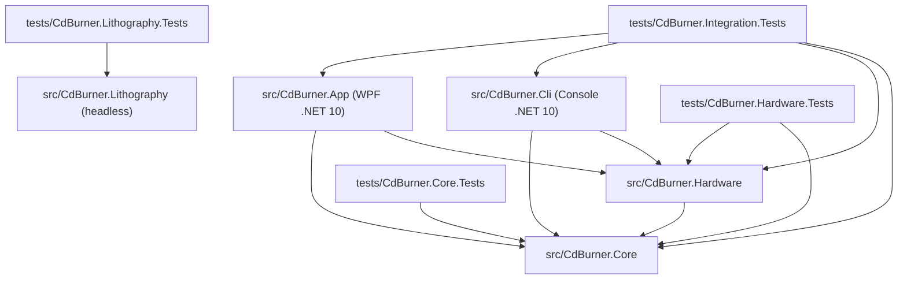
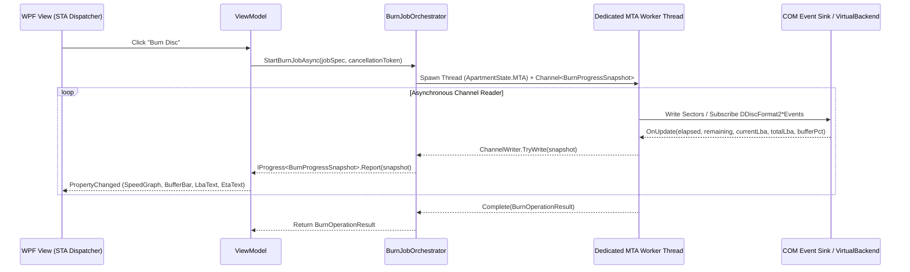

# CdBurner: System Architecture & Interop Blueprint

## 1. Architectural Principles
1. **Strict Layered Separation**:
   - `CdBurner.Core`: Zero dependencies on WPF or concrete Win32/COM classes. Contains all domain models, optical math (`LbaAddress`, `MsfAddress`), compilation trees, pure-C# ISO/El Torito/CUE/CD-Text/DVD-Video builders & parsers, and service interfaces.
   - `CdBurner.Hardware`: Implements `CdBurner.Core` hardware interfaces using Windows IMAPIv2 COM interop (`imapi2.dll`, `imapi2fs.dll`), Win32 `DeviceIoControl` (`IOCTL_SCSI_PASS_THROUGH_DIRECT`, `IOCTL_CDROM_RAW_READ`, `IOCTL_CDROM_READ_TOC_EX`), Windows Media Foundation (`IMFSourceReader`), and the `VirtualDiscBackend` simulator.
   - `CdBurner.Cli`: Command-line front-end exposing all operations with `--json` output and `--virtual` drive flags.
   - `CdBurner.App`: Windows 10/11 WPF Fluent UI application following strict MVVM (`CommunityToolkit.Mvvm`).
2. **100% Hardware-Free Testability**:
   - Every service in `CdBurner.Core` and `CdBurner.Hardware` can be exercised end-to-end against `VirtualDiscBackend` so automated `dotnet test` runs in CI never block waiting for a physical optical drive.

---

## 2. Solution & Project Dependency Graph



---

## 3. Core Abstractions (`src/CdBurner.Core/Abstractions/`)

```csharp
namespace CdBurner.Core.Abstractions;

public interface IDiscDeviceService
{
    IReadOnlyList<IDiscRecorderBackend> GetRecorders(bool includeVirtual = true);
    IDiscRecorderBackend? GetRecorderById(string uniqueId);
    event EventHandler<DeviceChangeEventArgs>? DeviceChanged;
}

public interface IDiscRecorderBackend : IDisposable
{
    string UniqueId { get; }
    string VendorId { get; }
    string ProductId { get; }
    string ProductRevision { get; }
    string VolumePath { get; } // e.g. "E:\" or "V:\Virtual0"
    bool IsVirtual { get; }

    DriveCapabilitiesDto GetCapabilities();
    MediaStatusDto QueryMediaStatus();
    void EjectMedia();
    void CloseTray();
    bool AcquireExclusiveAccess(string clientName);
    void ReleaseExclusiveAccess();
}

public interface IBurnEngineBackend
{
    Task<BurnOperationResult> BurnDataStreamAsync(
        IDiscRecorderBackend recorder,
        Stream imageStream,
        DataBurnOptions options,
        IProgress<BurnProgressSnapshot>? progress,
        CancellationToken cancellationToken);

    Task<BurnOperationResult> BurnAudioTracksAsync(
        IDiscRecorderBackend recorder,
        IReadOnlyList<AudioTrackSource> tracks,
        AudioBurnOptions options,
        IProgress<BurnProgressSnapshot>? progress,
        CancellationToken cancellationToken);

    Task<BurnOperationResult> EraseMediaAsync(
        IDiscRecorderBackend recorder,
        bool fullErase,
        IProgress<BurnProgressSnapshot>? progress,
        CancellationToken cancellationToken);

    Task<RipOperationResult> ReadSectorsAsync(
        IDiscRecorderBackend recorder,
        int startLba,
        int sectorCount,
        bool raw2352Mode,
        Func<int, ReadOnlyMemory<byte>, ValueTask> sectorConsumer,
        IProgress<BurnProgressSnapshot>? progress,
        CancellationToken cancellationToken);
}
```

---

## 4. Pinned Windows IMAPIv2 COM GUIDs (`src/CdBurner.Hardware/Interop/Imapi2Guids.cs`)

Use these exact GUID constants when declaring COM CoClasses and Interfaces:

```csharp
namespace CdBurner.Hardware.Interop;

public static class Imapi2Guids
{
    // CoClasses (CLSIDs)
    public const string CLSID_MsftDiscMaster2          = "2735412E-7F64-5B0F-8F00-5D77AFBE261E";
    public const string CLSID_MsftDiscRecorder2        = "2735412D-7F64-5B0F-8F00-5D77AFBE261E";
    public const string CLSID_MsftDiscFormat2Data      = "2735412A-7F64-5B0F-8F00-5D77AFBE261E";
    public const string CLSID_MsftDiscFormat2TAO       = "27354129-7F64-5B0F-8F00-5D77AFBE261E";
    public const string CLSID_MsftDiscFormat2RawCD     = "27354128-7F64-5B0F-8F00-5D77AFBE261E";
    public const string CLSID_MsftDiscFormat2Erase     = "2735412B-7F64-5B0F-8F00-5D77AFBE261E";
    public const string CLSID_MsftFileSystemImage      = "2C941FC5-975B-59BE-A960-9A2A262853A5";
    public const string CLSID_MsftBootOptions          = "2C941FCE-975B-59BE-A960-9A2A262853A5";
    public const string CLSID_MsftIsoImageManager      = "CEEE3B62-8F56-4056-869B-EF16917E3EFC";

    // Interfaces (IIDs)
    public const string IID_IDiscMaster2               = "27354130-7F64-5B0F-8F00-5D77AFBE261E";
    public const string IID_IDiscRecorder2             = "27354133-7F64-5B0F-8F00-5D77AFBE261E";
    public const string IID_IDiscRecorder2Ex           = "27354132-7F64-5B0F-8F00-5D77AFBE261E";
    public const string IID_IDiscFormat2Data           = "27354153-9F64-5B0F-8F00-5D77AFBE261E";
    public const string IID_IDiscFormat2TAO            = "27354154-8F64-5B0F-8F00-5D77AFBE261E";
    public const string IID_IDiscFormat2RawCD          = "27354155-8F64-5B0F-8F00-5D77AFBE261E";
    public const string IID_IDiscFormat2Erase          = "27354156-8F64-5B0F-8F00-5D77AFBE261E";
    public const string IID_IFileSystemImage           = "2C941FE1-975B-59BE-A960-9A2A262853A5";
    public const string IID_IFileSystemImage2          = "D7644B2C-1537-4767-B62F-F1387B02DDFD";
    public const string IID_IFileSystemImage3          = "7CFF842C-7E97-4807-8304-910DD8F7C051";
    public const string IID_IBootOptions               = "2C941FD4-975B-59BE-A960-9A2A262853A5";

    // Event Sinks (Connection Point IIDs, DISPID 0x200 = Update)
    public const string IID_DDiscMaster2Events         = "27354131-7F64-5B0F-8F00-5D77AFBE261E";
    public const string IID_DDiscFormat2DataEvents     = "2735413C-7F64-5B0F-8F00-5D77AFBE261E";
    public const string IID_DDiscFormat2TAOEvents      = "2735413D-7F64-5B0F-8F00-5D77AFBE261E";
    public const string IID_DDiscFormat2RawCDEvents    = "27354142-7F64-5B0F-8F00-5D77AFBE261E";
    public const string IID_DDiscFormat2EraseEvents    = "2735413A-7F64-5B0F-8F00-5D77AFBE261E";
}
```

---

## 5. Win32 SCSI Pass-Through Direct & MMC-5 Structures (`src/CdBurner.Hardware/Scsi/`)

To execute low-level MMC-5 commands (CD-Text read/write, raw CD-DA extraction, ATIP/ADIP media manufacturer ID lookup, C2 error scan, and DVD+R Book Type bitsetting), use `DeviceIoControl` on `\\.\CdRom0` or `\\.\E:` with `IOCTL_SCSI_PASS_THROUGH_DIRECT = 0x0004D014`:

```csharp
[StructLayout(LayoutKind.Sequential)]
public unsafe struct ScsiPassThroughDirect
{
    public ushort Length;              // sizeof(ScsiPassThroughDirect)
    public byte ScsiStatus;
    public byte PathId;
    public byte TargetId;
    public byte Lun;
    public byte CdbLength;             // 6, 10, 12, or 16
    public byte SenseInfoLength;       // e.g. 32
    public byte DataIn;                // SCSI_IOCTL_DATA_OUT = 0, SCSI_IOCTL_DATA_IN = 1, SCSI_IOCTL_DATA_UNSPECIFIED = 2
    public uint DataTransferLength;
    public uint TimeOutValue;          // Seconds
    public nint DataBuffer;            // Pointer to pinned buffer
    public uint SenseInfoOffset;       // Offset to SenseBuffer in wrapper struct
    public fixed byte Cdb[16];
}
```

### Standard MMC-5 OpCodes Supported by `MmcCommandBuilder`:
- `0x12` — `INQUIRY` (Vendor, Product, Firmware Revision)
- `0x46` — `GET CONFIGURATION` (Active Profile & Feature Descriptors)
- `0x51` — `READ DISC INFORMATION` (Disc Status, Erasable, Number of Sessions, Lead-In/Lead-Out)
- `0x43` — `READ TOC/PMA/ATIP` (Format `0x00` TOC, `0x02` Full TOC, `0x04` ATIP, `0x05` CD-Text)
- `0xAD` — `READ DISC STRUCTURE` (DVD Physical Format Information, Manufacturer ID, Copyright, Book Type)
- `0xBF` — `SEND DISC STRUCTURE` (DVD+R/+RW/+R DL Book Type Bitsetting)
- `0xBE` — `READ CD` (Raw 2352-byte sector + C2 error pointers + P-W subchannel extraction)
- `0x5D` — `SEND CUE SHEET` (DAO layout & Lead-In CD-Text reservation)
- `0x35` — `SYNCHRONIZE CACHE (10)`

---

## 6. Threading & Async Progress Pipeline



---

## 7. WPF Application Architecture (`src/CdBurner.App/`)

- **Dependency Injection**: `Microsoft.Extensions.DependencyInjection` configured in `App.xaml.cs`.
- **Navigation Shell (`MainWindow.xaml` & `MainViewModel.cs`)**:
  - **Left Navigation Rail**:
    1. `Data Disc` (`DataBurnViewModel`)
    2. `Audio CD` (`AudioBurnViewModel`)
    3. `DVD-Video` (`DvdVideoViewModel`)
    4. `Disc Image (ISO/CUE)` (`ImageStudioViewModel`)
    5. `Drive Utilities & Scan` (`DriveUtilitiesViewModel`)
    6. `Virtual Drive Manager` (`VirtualDriveViewModel`)
    7. `Settings & Logs` (`SettingsViewModel`)
  - **Top Hardware Ribbon**: Recorder ComboBox, Refresh button, Eject/Close Tray buttons, Virtual Media quick-mount dropdown, Write Speed selector, and Burn Mode pills.
  - **Bottom Capacity & Status Bar**: Animated segmented capacity progress bar (`Green` $\rightarrow$ `Amber` $\rightarrow$ `Red Overburn`), exact byte/LBA counter, and active background task indicator.

---

## 8. Lithography Module (`src/CdBurner.Lithography/`)

`CdBurner.Lithography` is a headless library (no WPF, no COM, no reference to Core or Hardware) for turning images
into disc-surface patterns. It holds the pure geometry in `Geometry/` (namespace `CdBurner.Lithography.Geometry`):
LBA and track length to radius and angle, polar page layout and a streaming rasterizer. Its tests live in
`tests/CdBurner.Lithography.Tests`. It was split out of Core so that code ported from an upstream project stays in
one assembly with a clear provenance boundary. Nothing in it touches a drive.

### Porting rules for upstream code (M5)

1. **Pinned upstream revision.** Port only from commit `619ec7505ac8955f35fe2f353ebda74b6ea90dda` of the upstream
   repository. Moving the pin is a deliberate change of its own, recorded in the commit message.
2. **Golden bytes first.** Before a ported routine is changed (renamed, restructured, optimized), capture its output
   for fixed inputs as golden bytes in a test and commit that test. Later changes must keep the bytes identical.
3. **Notices with the code.** The `THIRD-PARTY-NOTICES.md` entry (source URL, pinned SHA, license text, list of
   ported files) lands in the same commit as the first ported file, never before and never after. Each ported file
   also carries its origin and license in a header comment.
4. **License compatibility.** The ported code's license must be compatible with GPL-3.0-or-later; check this before
   porting, not after.
5. **Separation.** Ported files stay under their own folder inside this project so the provenance boundary is visible
   in the file tree. Clean-room code (such as `Geometry/`) never copies from upstream.
